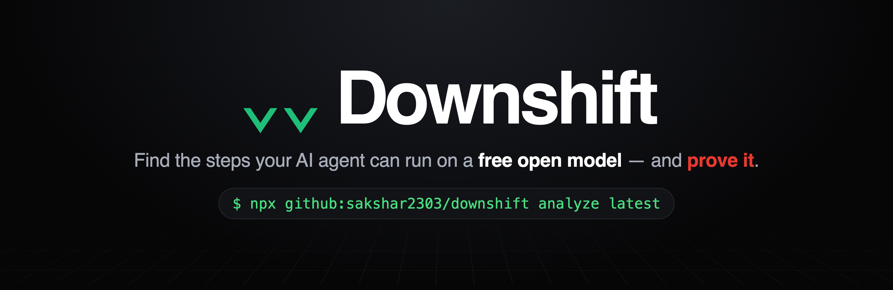
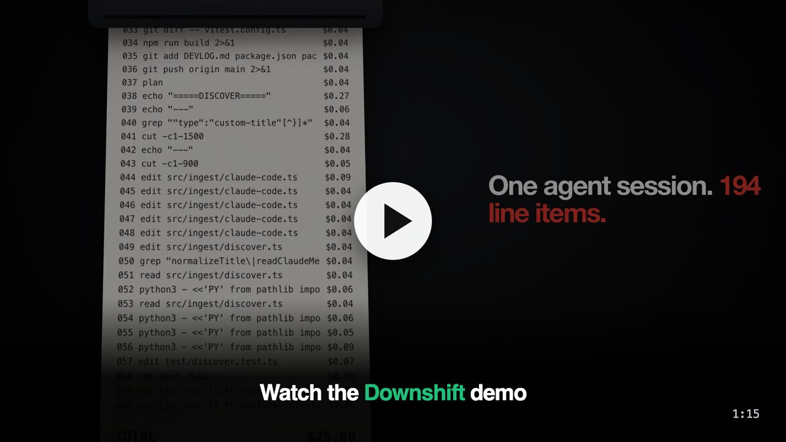
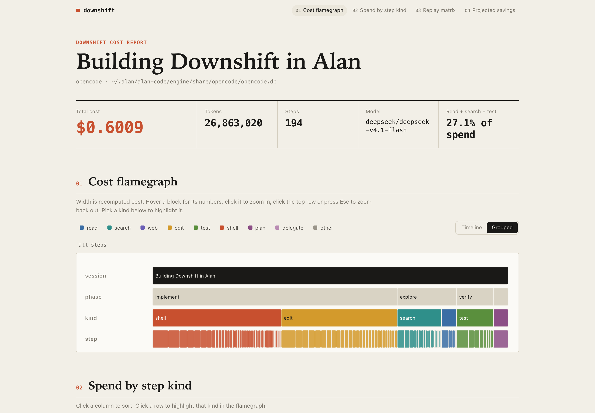
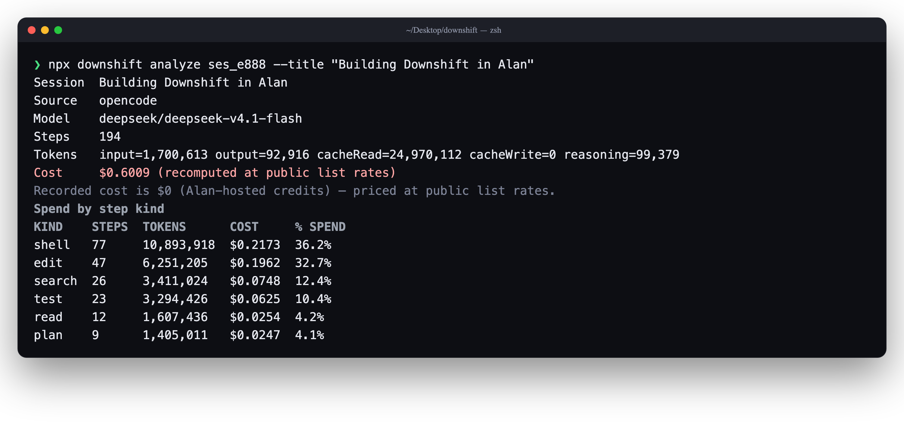
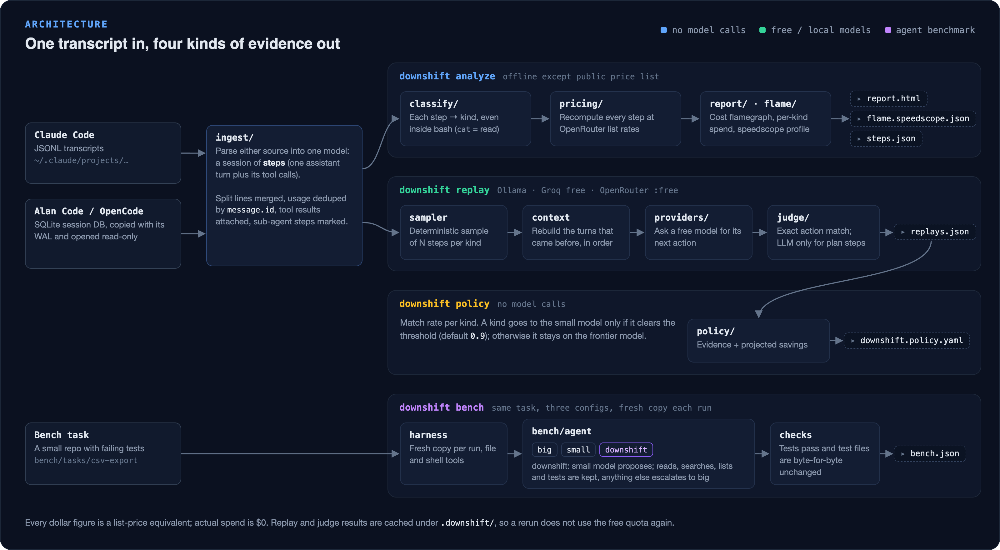
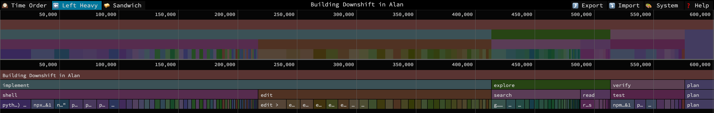
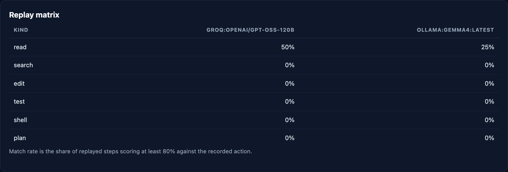
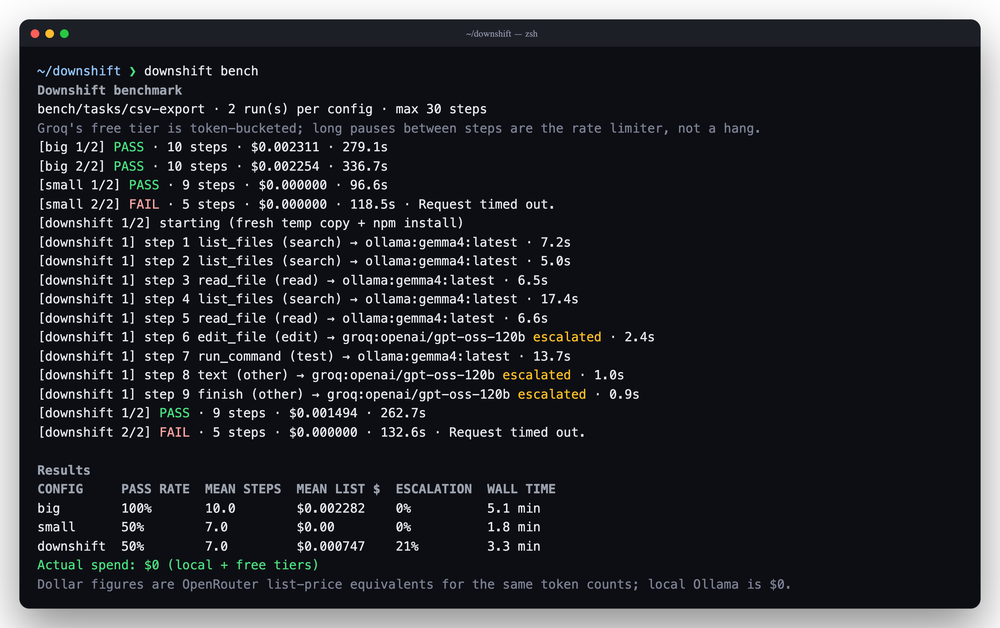

<p align="center"></p>

<p align="center">
  <a href="https://github.com/sakshar2303/downshift/actions/workflows/ci.yml"></a>
  <a href="LICENSE"></a>
  = 22">
  
  
</p>

<p align="center">
  <a href="#demo">Demo</a> ·
  <a href="#try-it-in-60-seconds">Quickstart</a> ·
  <a href="#architecture">Architecture</a> ·
  <a href="#results">Results</a> ·
  <a href="#commands">Commands</a> ·
  <a href="#development">Development</a>
</p>

Downshift finds the steps in a coding-agent session that an open model can
handle, then proves it by replaying them.

- **It measures** where a session's tokens and list-price cost go, broken down
  by step kind: read, search, edit, test, shell and plan.
- **It proves it** with replay, a mechanical judge and a speculative bench: the
  same sampled steps run on free models, tool calls are compared exactly, and
  the bench routes only safe step kinds to the small model.
- **It is free** to run: Ollama locally, plus Groq and OpenRouter free tiers. No
  credits, no paid fallback.

## Demo

<p align="center">
  <a href="https://sakshar2303.github.io/downshift/demo.mp4">
    
  </a>
</p>

Live sample report: https://sakshar2303.github.io/downshift/

## Try it in 60 seconds

### No keys, no setup

The repo ships a Claude Code transcript fixture. The transcript stays local;
only public price data is fetched.

```bash
git clone https://github.com/sakshar2303/downshift.git
cd downshift
npm install
npx tsx src/cli.ts analyze test/fixtures/claude-code.jsonl --open
```

### On your own agent

`analyze latest` reads the newest session the agent has already recorded.

```bash
npx github:sakshar2303/downshift analyze latest        # Claude Code
npx github:sakshar2303/downshift analyze latest:alan   # Alan Code
```

The `downshift` name on npm belongs to an unrelated React library. Use the
commands above.

<p align="center"></p>

*The generated cost report: flamegraph, totals and spend by step kind.*

<p align="center"></p>

*`analyze` prints the same totals before writing the report.*

## Architecture

<p align="center"></p>

Downshift treats one assistant turn plus the tools it called as the unit of
analysis. Nothing is instrumented: the input is the transcript the agent already
writes.

- **Ingest** parses Claude Code JSONL, or copies and reads the Alan Code /
  OpenCode SQLite database plus its WAL sidecars. Split assistant lines are
  merged, tool results attached, and every human turn kept.
- **Flamegraph** attributes recomputed cost and tokens to each step kind, then
  writes an HTML icicle chart and a speedscope profile.
- **Replay** deterministically samples steps per kind and replays them against a
  local or free model, rebuilding the conversation in chronological order.
- **Judge** scores replayed tool calls by exact action match (normalised paths,
  search terms, commands, edited text). Only plan steps, which have no tool call
  to compare, go to an LLM judge.
- **Policy** aggregates match rates per kind and emits a YAML routing rule, with
  the frontier model as the fallback and projected list-price savings.
- **Speculative bench** runs one task on the big model, the small model and a
  router. The router accepts only small-model reads, searches, listings and test
  commands; everything else escalates, and both calls are priced.

| Stage | Command | Modules | Writes | Calls a model? |
| --- | --- | --- | --- | --- |
| Cost map | `analyze` | `ingest/` `classify/` `pricing/` `report/` `flame/` | `downshift-report/report.html`, `flame.speedscope.json`, `steps.json` | No (fetches the public price list) |
| Replay | `replay` | `replay/` `providers/` `judge/` | `downshift-report/replays.json` | Yes, free or local |
| Policy | `policy` | `policy/` `report/` | `downshift.policy.yaml`, plus replay and savings sections in `report.html` | No |
| Bench | `bench` | `bench/` `providers/` `report/` | `downshift-report/bench.json`, plus a proof section in `report.html` | Yes, free or local |

### Core data model

Both readers produce the same shape, defined in `src/types.ts`:

- A **`Session`** has an `id`, a `source` (`claude-code` or `opencode`), an
  optional `title`, the first user message (kept for replay context) and an
  ordered list of steps.
- A **`Step`** is one assistant turn: `model`, `startedAt`, the `tools` it
  called (each a `ToolCall` with `name`, `input` and optional `output`), its
  `text`, the `userText` that prompted it, and `isSidechain` for sub-agent turns.
- **`tokens`** holds `input`, `output`, `cacheRead`, `cacheWrite` and
  `reasoning`. `recordedCostUsd` is what the transcript claims; `costUsd` is
  the list-price recomputation.
- **`kind`** is one of `read`, `search`, `web`, `edit`, `test`, `shell`, `plan`,
  `delegate` or `other`, set by `classify/`.

## Results

Every figure below is read from the generated report files in
`downshift-report/` and `downshift.policy.yaml`.

**Cost map — `downshift-report/steps.json`.** Session "Building Downshift in
Alan": 194 steps on `deepseek/deepseek-v4.1-flash`, 26,863,020 tokens
(1,700,613 input, 92,916 output, 24,970,112 cache read, 99,379 reasoning),
**$0.6009 list-price equivalent**.

| Kind | Steps | Share of list-price cost |
| --- | ---: | ---: |
| shell | 77 | 36.2% |
| edit | 47 | 32.7% |
| search | 26 | 12.4% |
| test | 23 | 10.4% |
| read | 12 | 4.2% |
| plan | 9 | 4.1% |

Read + search + test are 61 steps and **27.1%** of the recomputed spend.

<p align="center"></p>

*The same session in speedscope (Left Heavy): phase → kind → step. Load
[`docs/flame.speedscope.json`](docs/flame.speedscope.json) at
[speedscope.app](https://www.speedscope.app).*

**Replay and policy — `downshift-report/replays.json`,
`downshift.policy.yaml`.** 48 replay calls were made: 4 sampled steps per kind on
each of `ollama:gemma4:latest` and `groq:openai/gpt-oss-120b`. 15 calls failed
(12 Groq daily-token limits, 2 invalid tool calls, 1 connection error), 7
returned no tool call and scored 0, and 3 plan steps returned only `finish` and
were not scored. Of the 30 numeric scores, only 4 were above zero, and 2 cleared
the 0.8 action-match threshold: one read on each model.

At the policy's 0.9 threshold no kind qualified, so the emitted policy routes
all six kinds to the frontier model. Its evidence: read 0.5 over 2 samples;
search, edit, test and shell 0 over 4; plan 0 over 1. Neither free model was a
safe substitute on this session's sampled steps.

<p align="center"></p>

*Replay matrix from the report: share of sampled steps per kind whose replay
scored at least 0.8 against the recorded action.*

The start of the emitted `downshift.policy.yaml`:

```yaml
version: 1
frontier: deepseek/deepseek-v4.1-flash
threshold: 0.9
route:
  read: frontier
  search: frontier
  edit: frontier
  test: frontier
  shell: frontier
  plan: frontier
evidence:
  read:
    model: groq:openai/gpt-oss-120b
    matchRate: 0.5
    samples: 2
  # … evidence for the other kinds
```

**Speculative bench — `downshift-report/bench.json`.** Task
`bench/tasks/csv-export`, 2 runs per config, actual spend **$0**.

| Config | Pass rate | Mean steps | Mean list-price cost | Escalation |
| --- | ---: | ---: | ---: | ---: |
| big (`gpt-oss-120b`) | 1.00 | 10.0 | $0.002282 | — |
| small (`gemma4`) | 0.50 | 7.0 | $0 | — |
| downshift (small → big) | 0.50 | 7.0 | $0.000747 | 21.4% |

Best passing run of each config: big **$0.002254** (10 steps) vs downshift
**$0.001494** (9 steps, 3 escalated), so **33.7% cheaper** on list price, with
the tests passing in both.

Both failures were local-model request timeouts (`Request timed out.`): the
second small run and the second downshift run. The sample is 2 runs per config,
so these pass rates show the harness working rather than a general success rate.

<p align="center"></p>

*The bench run behind these numbers. The router kept the small model's reads,
searches and test run, and escalated the edit, a text reply and the finish
step to the big model.*

## Commands

Run from the repo with `npx tsx src/cli.ts <command>`, or `downshift <command>`
after a global install.

```bash
npm install -g github:sakshar2303/downshift
```

| Command | What it does | Most useful flag |
| --- | --- | --- |
| `sessions` | List the newest local agent sessions | `--source alan` |
| `analyze [target]` | Price a session and write the HTML report | `--open` |
| `replay [target]` | Replay sampled steps on free/local models | `--models ollama:gemma4:latest` |
| `policy [report]` | Turn replay scores into a routing policy | `--threshold 0.9` |
| `bench` | Run big, small and routed agents on a task | `--task bench/tasks/csv-export` |
| `doctor` | Probe Ollama, Groq and OpenRouter | none |

`analyze` and `policy` do not call a model. `replay` and `bench` call live
models and are slow on free tiers; they cache results under `.downshift/`, so a
rerun does not spend the free quota twice.

## Zero-cost by design

- **Ollama** runs locally and is priced at $0.
- **Groq** uses the free tier with token-bucket aware rate limiting.
- **OpenRouter** is restricted to `:free` model ids; a guard refuses anything
  else unless `--allow-paid` is passed explicitly.
- Replay and judge results are cached on disk and keyed by model plus prompt, so
  reruns cost nothing and stay reproducible offline.
- Every dollar figure is a **list-price equivalent** computed from OpenRouter's
  public rates, not money spent. Alan-hosted steps record `cost: 0`; the report
  says so wherever a total appears.

## Supported sources

- **Claude Code** JSONL transcripts under `~/.claude/projects/<project>/`.
- **Alan Code / OpenCode** SQLite sessions at
  `~/.alan/alan-code/engine/share/opencode/opencode.db` and
  `~/.local/share/opencode/opencode.db`. The database is copied with its `-wal`
  and `-shm` files and opened read-only, so a live agent is not disturbed.

Sidechain (sub-agent) steps are read for accounting but excluded from replay
sampling and replay context.

## Design decisions

- **Dedupe by `message.id`.** Claude Code writes one assistant response across
  several JSONL lines and repeats the full usage object on each. Counting lines
  would triple the tokens; usage is taken once per message id.
- **Recompute prices from list rates.** Alan records `cost: 0` for hosted usage,
  so trusting the transcript would make every session look free. The recorded
  value is kept for provenance only.
- **Deterministic first, LLM only where necessary.** Replayed tool calls are
  compared mechanically. Only plan steps go to the LLM judge, which gets a
  narrow question, a zod-validated JSON answer and one retry.
- **Sample and cache for free tiers.** Replaying every step would exhaust the
  free quota, so steps are sampled per kind and every result is cached.
- **Measure speculative routing instead of assuming it.** The bench counts
  rejected small-model proposals, escalates the rest, prices both calls, and
  requires the task's test files to remain byte-for-byte unchanged.

## Limitations

- Transcripts do not contain the original system prompt, so replay context is a
  neutral reconstruction plus prior turns.
- Counterfactuals are single-step: a replay changes one step in isolation and
  assumes the rest of the trajectory would still happen.
- The replay sample is small and uneven. 15 of 48 calls failed, mostly on Groq's
  daily token cap, so some kinds have four scored samples and some have fewer.
  The 0.8 match and 0.9 policy conclusions rest on that sample.
- The bench is one small task with two runs per config. Two of six runs, both
  starting on the local model, hit a request timeout. It demonstrates the
  routing loop end to end; it is not a general success-rate estimate.
- OpenRouter publishes no cache-write rate. Downshift approximates it as 1.25x
  the prompt rate for `anthropic/*` models and the prompt rate otherwise.

## Project layout

```
src/
  cli.ts            command wiring and terminal output
  types.ts          shared session, step and token types
  paths.ts          shortens absolute paths for display
  ingest/           Claude Code JSONL and OpenCode SQLite readers
  classify/         step-kind rules (read, search, edit, test, shell, plan)
  pricing/          OpenRouter list prices and model mapping
  report/           self-contained HTML cost report
  flame/            speedscope profile and phase grouping
  replay/           deterministic sampling, context rebuild, model calls
  judge/            action-match scoring and the plan-step LLM judge
  policy/           per-kind evidence and YAML routing policy
  bench/            big/small/routed agents and the task harness
  providers/        Ollama, Groq and OpenRouter clients, doctor
```

## Development

```bash
npm run check   # typecheck, 267 tests, build
```

Tests are Vitest files under `test/`, with unit tests per module (ingest,
classify, pricing, replay, judge, policy, bench, report) plus integration tests
for the bench agent and the HTML report. `test/fixtures/claude-code.jsonl` is
the key-free fixture used above.

CI runs on Node 22 and 24 (`ubuntu-latest`): `npm ci`, typecheck, tests, build,
a `--help` smoke test, and an `analyze` smoke test that is allowed to fail when
OpenRouter pricing cannot be fetched.

## Built with Alan

Every step was built in an Alan Code session running DeepSeek V4.1 Flash. The
sessions themselves became the dataset the tool was developed against. Notes on
what worked, what was hard and what the platform could improve are in
[ALAN-FEEDBACK.md](ALAN-FEEDBACK.md); the chronological build log is in
[DEVLOG.md](DEVLOG.md).

## License

MIT. See [LICENSE](LICENSE).
